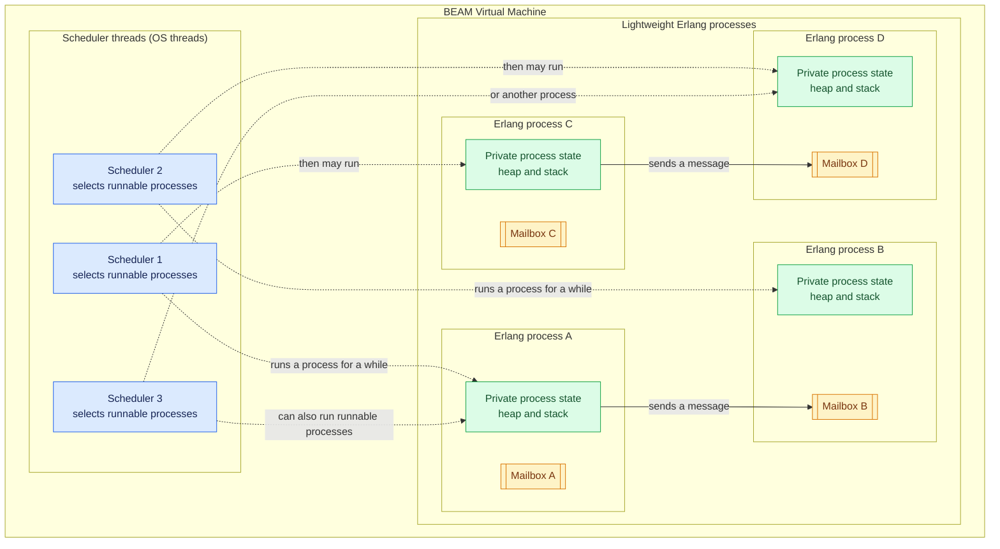

# Erlang Relay Tree and Connection Gateway

This repository contains two Erlang/OTP applications:

* **Relay tree** — broadcasts messages through a hierarchical tree of relay
  processes.
* **Connection gateway** — creates channels and lets WebSocket clients
  subscribe and publish to them.

The full beginner guide starts with the BEAM scheduler and application
architecture diagram, then walks through cloning, setup, running both
applications, API/WebSocket examples, and Postman collections:
[docs/ERLANG-GATEWAYS.md](docs/ERLANG-GATEWAYS.md).

## How Erlang runs: the BEAM VM

This is the **general Erlang runtime model**, not this project's application
topology:



Each Erlang process is a small, isolated unit of execution with its own
mailbox and process state; it is **not** an operating-system thread. BEAM
scheduler threads run many runnable Erlang processes, switching between them.
A process is not permanently assigned to one scheduler. Processes communicate
by sending messages, which are received through the recipient's mailbox.

## Quick start (Windows PowerShell)

Install **Erlang/OTP 27 or later** and **Rebar3**, then run:

```powershell
git clone --branch main https://github.com/rojamuthiah/connection-gateway.git relay_tree
Set-Location .\relay_tree
Copy-Item .env.example .env
rebar3 compile
rebar3 eunit
rebar3 shell --env-file .env
```

The Rebar3 shell starts both applications. Leave it running while using either
server:

* Relay tree: `http://127.0.0.1:8000`
* Connection gateway: `http://127.0.0.1:8001`

Erlang does not load `.env` automatically; `--env-file .env` tells Rebar3 to
load it for this shell. Stop the servers with **Ctrl+C** in the Rebar3 shell.

## Configure ports and logs

Edit `.env` before starting the Rebar3 shell. Defaults are documented in
`.env.example`:

| Variable | Default | Description |
|---|---:|---|
| `RELAY_TREE_PORT` | `8000` | Relay-tree HTTP and WebSocket listener port. |
| `CONNECTION_GATEWAY_PORT` | `8080` | Channel gateway HTTP and WebSocket listener port. |
| `CONNECTION_GATEWAY_MAX_CONNECTIONS` | `4096` | Ranch listener connection limit for the channel gateway. |
| `CONNECTION_GATEWAY_BAD_WORK_MS` | `250` | CPU-work duration, in milliseconds, before a `publish_bad` message is broadcast (valid range: 1–10,000). |
| `CONNECTION_GATEWAY_LOG_FILE` | `logs/connection-gateway.log` | Channel gateway structured log file. |

Generated logs are ignored by Git.

## Where to go next

For endpoint details, request and WebSocket publish examples, Postman
collection links, BEAM scheduler/process explanations, log troubleshooting,
and the optional Python benchmark instructions, continue through
[the full guide](docs/ERLANG-GATEWAYS.md).
