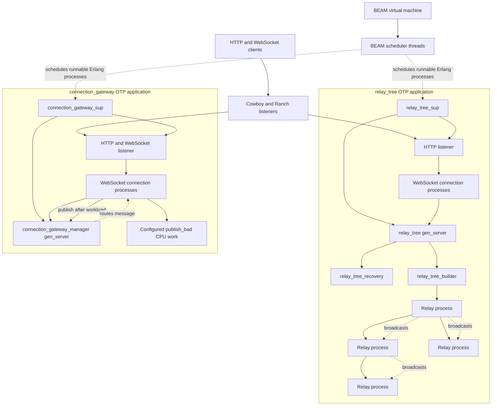

# Erlang Relay Tree and Connection Gateway

## BEAM scheduler and application architecture



### What the diagram means

* The **BEAM** is the Erlang virtual machine. It runs many lightweight Erlang
  processes; these are not one operating-system thread per process.
* BEAM **scheduler threads** execute runnable Erlang processes. The VM normally
  starts scheduler threads based on the machine's available CPU cores. Check
  the running VM with `erlang:system_info(schedulers_online).` and
  `erlang:system_info(schedulers).` in the Erlang shell.
* Cowboy/Ranch accepts HTTP and WebSocket connections. Each WebSocket is
  handled by an Erlang process, which BEAM schedulers can run independently.
* A **gen_server** owns shared state and handles its calls serially. It is
  appropriate for maintaining consistent channel/tree state, but CPU work
  placed inside one manager would serialize with the manager's other calls.
* In the connection gateway, each `publish_bad` WebSocket handler validates
  the publish with the manager, runs its configured CPU workload in that
  WebSocket's own process, and then asks the manager to broadcast. Concurrent
  publishers can therefore run their workloads on separate BEAM processes.
  Actual speedup depends on available schedulers and CPU load; BEAM processes
  do not guarantee that elapsed time is exactly 250 ms for any number of jobs.
* In the relay-tree application, the manager builds and monitors a binary tree
  of relay processes. A broadcast travels through relay processes and reaches
  clients subscribed to leaf relays.

## Repository

The Erlang source contains two OTP applications in one Rebar3 project:

* `apps/relay_tree/` — a hierarchical relay tree and its HTTP/WebSocket API.
* `apps/connection_gateway/` — channel creation and channel-based
  WebSocket subscribe/publish API.

## Clone

In PowerShell, clone the `main` branch and enter the project directory:

```powershell
git clone --branch main https://github.com/rojamuthiah/connection-gateway.git relay_tree
Set-Location .\relay_tree
```

If you already have the project, change to its directory instead:

```powershell
Set-Location C:\projects\relay_tree
```

## Prerequisites and setup

Install Erlang/OTP **27 or later** (the tree API uses OTP's built-in `json`
module) and Rebar3. Confirm both commands are available:

```powershell
erl -version
rebar3 version
```

Copy the example environment file, then compile and run the test suite:

```powershell
Copy-Item .env.example .env
rebar3 compile
rebar3 eunit
```

The example configuration is:

```dotenv
RELAY_TREE_PORT=8000
CONNECTION_GATEWAY_PORT=8001
CONNECTION_GATEWAY_MAX_CONNECTIONS=4096
CONNECTION_GATEWAY_BAD_WORK_MS=250
CONNECTION_GATEWAY_LOG_FILE=logs/connection-gateway.log
```

Erlang does **not** load `.env` automatically. The `--env-file .env` option in
the commands below asks Rebar3 to load these values for the shell. Relative log
paths are relative to the project directory from which Rebar3 is launched.

## Run both Erlang servers

From the project root:

```powershell
rebar3 shell --env-file .env
```

The Rebar3 shell configuration starts both OTP applications. Their listeners
are available at:

* Relay tree: `http://127.0.0.1:8000`
* Connection gateway: `http://127.0.0.1:8001`

Keep the shell open while sending requests. Stop the applications with
**Ctrl+C** in the Rebar3 terminal.

### Environment variables

| Variable | Default | Description |
|---|---:|---|
| `RELAY_TREE_PORT` | `8000` | Relay-tree HTTP and WebSocket listener port. |
| `CONNECTION_GATEWAY_PORT` | `8080` | Channel gateway HTTP and WebSocket listener port. |
| `CONNECTION_GATEWAY_MAX_CONNECTIONS` | `4096` | Ranch listener connection limit for the channel gateway. |
| `CONNECTION_GATEWAY_BAD_WORK_MS` | `250` | CPU-work duration in milliseconds before a `publish_bad` message is broadcast (valid range: 1–10,000). |
| `CONNECTION_GATEWAY_LOG_FILE` | `logs/connection-gateway.log` | File receiving the channel gateway's structured OTP logs. |

The channel gateway logs channel creation, WebSocket connection/subscription
and disconnection events, and unknown-channel subscription errors. Generated
logs are ignored by Git.

## Relay-tree application

### Endpoints

Base URL: `http://127.0.0.1:8000`

| Method | Path | Purpose |
|---|---|---|
| `GET` | `/health` | Health response. |
| `POST` | `/tree/create` | Create or replace a relay tree. JSON body: `{"layers": 4}`. Layers must be an integer from 0 to 10. |
| `GET` | `/tree` | Return the root PID and relay/leaf counts. |
| `GET` | `/tree/relays` | List relay IDs, PIDs, levels, parents, and children. |
| `GET` | `/tree/leaves` | List current leaf relay details. |
| `POST` | `/publish` | Broadcast a non-empty raw message body (up to 1 MiB). |
| WebSocket | `/ws` | Connect a client to a leaf to receive broadcasts. |

The tree is a full binary tree. `layers: 0` creates one relay, which is also a
leaf. For example, `layers: 2` creates 7 relay processes and 4 leaves. Clients
are distributed across leaves as WebSocket connections are established. To
publish, post raw text to `/publish`; the WebSocket endpoint is receive-only
and ignores client frames.

### Relay-tree publish examples

Create a tree with two layers:

```powershell
Invoke-RestMethod `
  -Method Post `
  -Uri http://127.0.0.1:8000/tree/create `
  -ContentType application/json `
  -Body '{"layers":2}'
```

Publish a text message to all connected tree clients:

```powershell
Invoke-RestMethod `
  -Method Post `
  -Uri http://127.0.0.1:8000/publish `
  -ContentType text/plain `
  -Body 'Hello from the relay tree'
```

The publish endpoint returns `202 Accepted` when the message is accepted. A
client connects to `ws://127.0.0.1:8000/ws` and receives the message as a text
frame. No subscribe JSON message is needed for this WebSocket.

## Channel-based connection gateway

### Endpoints and message protocol

Base URL: `http://127.0.0.1:8001`

| Method | Path | Purpose |
|---|---|---|
| `GET` | `/health` | Health response. |
| `POST` | `/channels` | Create a channel with a unique ID. |
| WebSocket | `/ws` | Subscribe and publish messages to channels. |

Create a channel before subscribing:

```powershell
Invoke-RestMethod `
  -Method Post `
  -Uri http://127.0.0.1:8001/channels `
  -ContentType application/json `
  -Body '{"channelId":"stream-101"}'
```

Connect a WebSocket client to:

```text
ws://127.0.0.1:8001/ws
```

Send these JSON **text frames** on that WebSocket, in order:

1. Subscribe to the existing channel:

   ```json
   {"type":"subscribe","channelId":"stream-101"}
   ```

   Successful response:

   ```json
   {"type":"subscribed","channelId":"stream-101","connectionId":"conn-1"}
   ```

   The actual connection ID is generated by the server.

2. Publish a normal message:

   ```json
   {"type":"publish_normal","channelId":"stream-101","message":"Hello everyone"}
   ```

3. Or publish a bad/workload message:

   ```json
   {"type":"publish_bad","channelId":"stream-101","message":"EXPENSIVE"}
   ```

Both publish types broadcast a `message` event to **other subscribers of the
same channel**. The publishing connection does not receive its own message:

```json
{"type":"message","channelId":"stream-101","message":"Hello everyone"}
```

For `publish_bad`, the publishing WebSocket process runs a CPU workload for the
duration configured by `CONNECTION_GATEWAY_BAD_WORK_MS` (250 ms by default)
before broadcasting. The value must be an integer from 1 to 10,000; an invalid
value prevents the gateway listener from starting. Change it in `.env` and
restart the Rebar3 shell for the new value to take effect. Multiple bad
publishes sent concurrently from distinct connections can run their workloads
in separate Erlang processes. A channel with only one subscriber can still
accept a publish, but there are no other clients to receive its broadcast.

## Postman collections

Import either collection into Postman using **Import → File**:

* [Relay tree HTTP collection](../connection-gateway-erl.postman_collection.json)
  — health/tree inspection, create tree, and HTTP publish requests. To receive
  broadcasts, create a separate Postman WebSocket request to
  `ws://127.0.0.1:8000/ws`.
* [Connection gateway collection](../connection-gateway-channels.postman_collection.json)
  — create a channel. Then create a separate Postman WebSocket request to
  `ws://127.0.0.1:8001/ws` and send the subscribe and publish JSON text frames
  shown above.

The collections use `localhost` as their base URL by default. If your local
machine resolves `localhost` to an IPv6 address that the listener does not
accept, use `127.0.0.1` in the collection variable or WebSocket URL.

## Logs and troubleshooting

Watch the channel gateway log file from a second PowerShell window:

```powershell
Get-Content .\logs\connection-gateway.log -Wait
```

If a WebSocket reports `unknown_channel`, make sure the `POST /channels`
request and WebSocket connection are reaching the same running Erlang gateway
instance. Channels are kept in memory and disappear when the application
restarts. Confirm the configured ports and that the Rebar3 shell is still
running.

To confirm the number of online BEAM schedulers while in the Erlang shell:

```erlang
erlang:system_info(schedulers_online).
erlang:system_info(schedulers).
```

## Benchmark client

The optional Python benchmark script is in `scripts/benchmark_gateways.py`.
From the project root, install its dependencies and run it:

```powershell
py -m pip install -r requirements-benchmark.txt
py scripts/benchmark_gateways.py
```

It benchmarks the Erlang gateway at `127.0.0.1:8001` and the JavaScript
gateway at `127.0.0.1:8080`; start both servers before running it. The
`ENABLE_BAD_MESSAGES` and `BAD_MESSAGES_PER_CHANNEL` settings near the top of
the script control the bad-publish phase. The script sends those bad publishes
concurrently, using a distinct publisher connection for each publish. The
remaining connection, timeout, normal-publish, and URL settings can be passed
as command-line options; see:

```powershell
py scripts/benchmark_gateways.py --help
```
